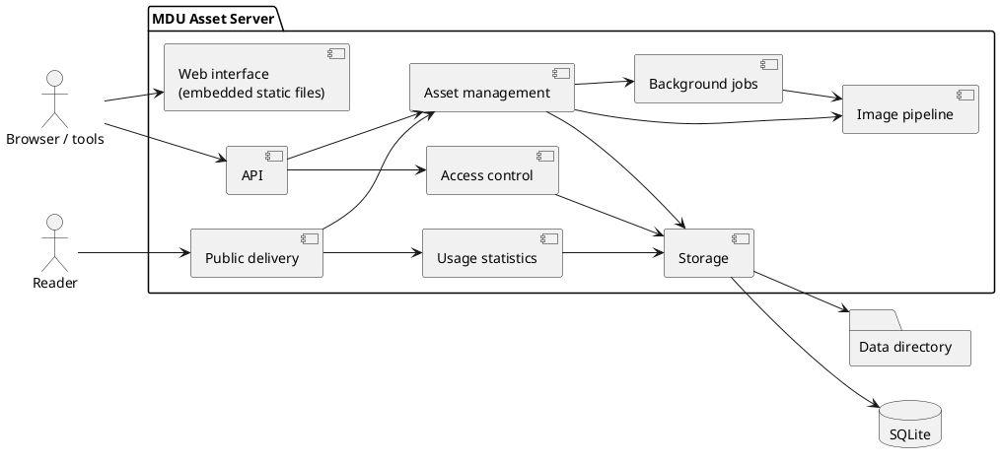

# Building Block View

> [!NOTE]
> Planned structure. Names of projects and namespaces are fixed when milestone M0 creates the solution; this page then describes the code as it is.

## Level 1: the server

| Building block | Responsibility | Requirements |
| --- | --- | --- |
| Web interface | Static HTML, CSS and JavaScript embedded in the binary; talks only to the API | UI-01 – UI-07 |
| API | Minimal API endpoints under `/api/v1`, validation, problem details, OpenAPI document | API-01 – API-07 |
| Public delivery | `/i/<id>/…` on the public host: resolves the asset, picks the variant, sets caching and security headers | DLV-01 – DLV-08 |
| Access control | Users, passwords, API tokens, roles and permission checks, rate limits | AUTH-*, PRJ-03, OPS-05 |
| Asset management | Projects, folders, tags, assets, versions, pairs, trash, quotas, audit log, export and import | PRJ-*, ORG-*, VER-*, DEL-*, OPS-* |
| Image pipeline | Type detection, SVG sanitizing, metadata stripping, thumbnails, resized and converted variants (NetVips) | UP-06 – UP-08, DLV-03, DLV-04, DLV-06 |
| Background jobs | Bounded in-process queue for AVIF variants, trash cleanup and retention tasks | DLV-04, DEL-02, OPS-03 |
| Usage statistics | Counts requests in memory and writes them in batches; referrer and bot filtering | STA-01 – STA-06 |
| Storage | SQLite access with migrations, content-addressed blob store, variant cache | NF-02, NF-05 |

## Level 2: planned solution layout

| Project | Contents |
| --- | --- |
| `Source/MduAssets` | Host: configuration, dependency injection, endpoint mapping, embedded UI files, command-line entry (`serve`, `backup`) |
| `Source/MduAssets.Core` | Domain model and use cases: projects, assets, versions, folders, permissions; no ASP.NET Core dependency |
| `Source/MduAssets.Storage` | SQLite repositories, migrations, blob store, variant cache |
| `Source/MduAssets.Imaging` | NetVips wrapper, SVG sanitizer, variant rules |
| `Source/*.Test` | xUnit tests per project, plus HTTP-level tests against the host |

The split keeps NetVips and SQLite behind small interfaces, so the core can be tested without native libraries and a storage backend could be added later without touching the use cases.
