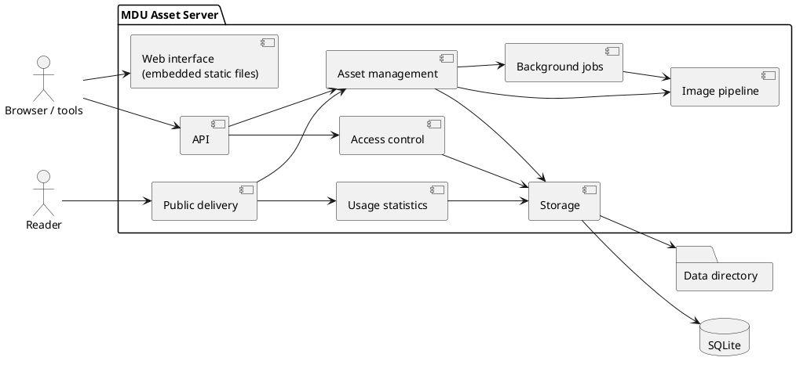

# Building Block View

> [!NOTE]
> Level 1 shows the target structure. Level 2 lists the projects that exist today and the ones planned for later milestones.

## Level 1: the server

| Building block | Responsibility | Requirements |
| --- | --- | --- |
| Web interface | Static HTML, CSS and JavaScript embedded in the binary; talks only to the API | UI-01 – UI-07 |
| API | Minimal API endpoints under `/api/v1`, validation, problem details, OpenAPI document | API-01 – API-07 |
| Public delivery | `/i/<id>/…` on the public host: resolves the asset, picks the variant, sets caching and security headers | DLV-01 – DLV-08 |
| Access control | Users, passwords, API tokens, roles and permission checks, rate limits | AUTH-*, PRJ-03, OPS-05 |
| Asset management | Projects, folders, tags, assets, versions, pairs, trash, quotas, audit log, export and import | PRJ-*, ORG-*, VER-*, DEL-*, OPS-* |
| Image pipeline | Type detection, SVG sanitizing, metadata stripping, thumbnails, resized and converted variants (NetVips) | UP-06 – UP-08, DLV-03, DLV-04, DLV-06 |
| Background jobs | Bounded in-process queue for AVIF variants, trash cleanup and retention tasks | DLV-04, DEL-02, OPS-03 |
| Usage statistics | Counts requests in memory and writes them in batches; referrer and bot filtering | STA-01 – STA-06 |
| Storage | SQLite access with migrations, content-addressed blob store, variant cache | NF-02, NF-05 |

## Level 2: solution layout

The solution is `Source/MduAssets.slnx`. Everything that compiles lives under `Source/`.

| Project | Contents | Status |
| --- | --- | --- |
| `MduAssets` | Host, published as the `mdu-assets` program: `ServerSettings` (validated configuration), logging, request log, health check, startup checks; `Security/` (Basic Auth handler, PBKDF2 hashing, credential cache, first admin); `Api/` (upload, list, detail and edit endpoints, file names, snippets, JSON source generation); `Delivery/` (public links); `Web/UiFiles` (serves the embedded web interface with its content security policy); `Ui/` (the web interface: `index.html`, `app.js`, `app.css`, the copied `tokens.css` with its pin file). Later: commands such as `backup` | Since M0 |
| `MduAssets.Storage` | `DataDirectory` (folder layout), `Database` (SQLite connections in WAL mode), `MigrationRunner` with embedded `Migrations/NNNN_name.sql`, `BlobStore` (content-addressed files), `UserStore`, `AssetStore` (projects, assets, versions), `AssetId`; later the variant cache | Since M0 |
| `MduAssets.Imaging` | `ImageDetector` (type and size from the header, [ADR-0013](Architecture-Decisions/0013-Image-Headers-Without-an-Image-Library.md)), `SvgSanitizer` ([ADR-0012](Architecture-Decisions/0012-Own-SVG-Sanitizer.md)); later the NetVips wrapper and variant rules | Since M1 |
| `MduAssets.Core` | Domain model and use cases: projects, assets, versions, folders, permissions; no ASP.NET Core dependency. Until roles and versions arrive, the few use cases live in the endpoints | Planned (M3) |
| `MduAssets.Test`, `MduAssets.Storage.Test`, `MduAssets.Imaging.Test` | xUnit v3 tests; HTTP-level tests against the host with a temporary data directory and two host names | Since M0 |
| `Spikes/NetVipsAot` | [NetVips AOT spike](NetVips-AOT-Spike.md), kept running in CI | Since the spike |
| `Tools/SyncTokens` | Copies `tokens.css` from the MDU design system and writes the pin file ([ADR-0010](Architecture-Decisions/0010-MDU-Design-Tokens.md)) | Since M2 |

The split keeps NetVips and SQLite behind small interfaces, so the core can be tested without native libraries and a storage backend could be added later without touching the use cases.
