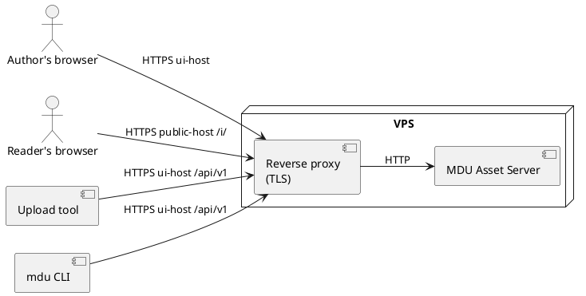

# Context and Scope

## Business context

```context
accTitle: MDU Asset Server in its environment
Server[MDU Asset Server]
actor Author as Documentation author
actor Admin as Administrator
Author -. Uploads, organizes, copies snippets .-> Server
Admin -. Manages users and projects .-> Server
Tools[Upload tools<br>ShareX, curl, scripts] --> Server
Cli[mdu CLI] --> Server
Sites[MDU sites in readers' browsers] --> Server
```

| Partner | Exchanged |
| --- | --- |
| Documentation author | Images in (drop, paste, file picker); Markdown snippets, links and statistics out |
| Administrator | Users, projects, quotas and settings in; overview and audit log out |
| Upload tools | Image files in through the API with an API token; link and snippet out |
| `mdu` CLI | `mdu assets upload` sends files and prints snippets; `mdu lint` asks whether asset links still exist |
| MDU sites in readers' browsers | Image requests with an optional `Referer`; image files out |

Out of scope: editing Markdown, hosting MDU sites, image editing beyond resizing and format conversion, and file types other than images.

## Technical context



| Interface | Host | Protocol and format | Authentication |
| --- | --- | --- | --- |
| Web interface | UI host | HTTPS, static HTML/CSS/JS | Basic Auth (later session, OIDC, passkeys) |
| JSON API `/api/v1` | UI host | HTTPS, JSON, `multipart/form-data` or raw image body, errors as `application/problem+json`, described as OpenAPI | Basic Auth or `Authorization: Bearer <token>` |
| Public check endpoint `/api/v1/public/check` | UI host | HTTPS, JSON | None; returns only a status per URL; rate limited |
| Public links `/i/<id>/<name>` | Public host | HTTPS, image bytes, conditional and range requests, `Accept` negotiation | None; IDs are unguessable |
| Health `/healthz` | Internal | HTTP | None |

The UI host and the public host are separate host names set in the configuration (see [ADR-0009](Architecture-Decisions/0009-Separate-Public-Host.md)). TLS ends at the reverse proxy.
