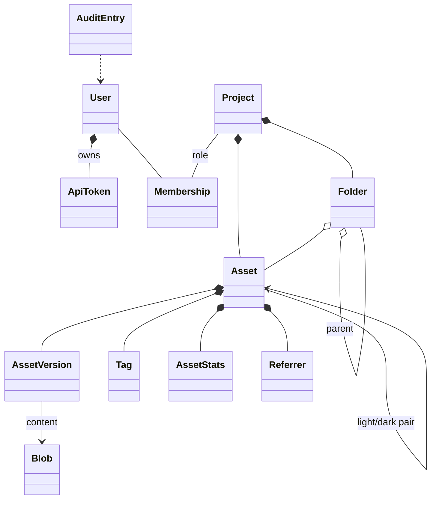

# Crosscutting Concepts

## Domain model

- **Asset** is the unit behind a public link. Its ID never changes and is never reused.
- **AssetVersion** is immutable. Replacing an asset adds a version; restoring copies an old version into a new one.
- **Blob** is file content addressed by its SHA-256. Versions with identical content share a blob.
- **Folder** and **Tag** are pure organization. Neither appears in a link.

The table sketch is in section 8 of the [requirements](../Requirements.md#8-datenmodell-skizze).

## Security

| Concern | Concept |
| --- | --- |
| Authentication | Basic Auth for the UI and API, accepted only when the request is HTTPS, directly or as reported by a trusted proxy. PBKDF2-SHA256 with 600,000 iterations; because Basic Auth sends the password with every request, a verified password is remembered for five minutes in memory, keyed by a hash of user, stored hash and password. Locked users are rejected on the next request. Personal API tokens (shown once, stored as hash, scoped, expiring) for tools from M8. Later: session login, passkeys, OIDC. |
| Authorization | Every project endpoint asks `ProjectAccess` for the caller's role before it acts: viewers read and copy, editors also upload and change images, owners also manage members and the project; admins act as owners everywhere (matrix in section 4.2 of the requirements). Projects the caller cannot see answer 404, so their names do not leak; too little rights answer 403. User management, settings and the overview need the admin role. A project keeps at least one owner, and the instance at least one unlocked admin; both are checked inside the database transaction that makes the change. |
| Start passwords | Admins never choose passwords for others: creating a user or resetting a password generates a 16-character start password, shown once and stored only as a hash. Until the user replaces it, every API request except `GET /api/v1/me` and `POST /api/v1/me/password` answers 403 with the problem type `urn:mdu-assets:problem:password-change-required`. Changing a password needs the current one. |
| Public links | Capability URLs: unauthenticated, but with random IDs of at least 10 base62 characters; 404s are rate limited to make guessing pointless. |
| Web interface | Served only on the UI host and only to signed-in users. A strict content security policy allows scripts, styles and requests only from the UI host itself and images also from the public host; no inline scripts or styles, no framing. |
| Cross-site requests | Browsers send cached Basic Auth credentials along with requests from any site. Every request other than `GET`, `HEAD` and `OPTIONS` is rejected with 403 when `Sec-Fetch-Site` is neither `same-origin` nor `none`, or when `Origin` is not the UI origin. Tools such as curl send neither header. |
| Data protection keys | ASP.NET Core keeps its keys in `keys/` in the data directory, readable only by the server user and not encrypted. Nothing uses them yet; session sign-in (AUTH-09) has to encrypt them first. |
| Uploads | Type from content, not from the name; size and pixel limits before decoding; SVG sanitized on upload; served with `nosniff` and, for SVG, a sandboxing CSP; served only from the public host. |
| Privacy | EXIF and GPS removed from images; statistics keep counts, times and referrer pages only, no IP addresses or user agents; no cookies on the public host. |
| Abuse | Rate limits for sign-in, uploads, the public check endpoint and 404s; quotas per project. |
| Audit | Security-relevant and content-changing actions are written to the audit log. |

## Persistence

- SQLite in WAL mode, accessed with `Microsoft.Data.Sqlite` and hand-written SQL, which works under Native AOT.
- Schema migrations are numbered, applied on start inside a transaction, and never edited after release.
- File content is written once to `blobs/` through a temporary file and an atomic rename, then referenced from the database. A blob is deleted only when no version refers to it any more.
- Derived variants live in `variants/` and are a cache: deleting the folder only costs CPU.

## HTTP and caching

- Current-version links: `Cache-Control: public, max-age=300, stale-while-revalidate=86400`, strong ETag per variant. A replaced image reaches readers within minutes.
- Version links `/v<n>/`: `Cache-Control: public, max-age=31536000, immutable`.
- Format negotiation by `Accept` with `Vary: Accept`; only configured widths for `?w=` so the variant cache stays bounded.
- Conditional requests (`If-None-Match`, `If-Modified-Since`), `HEAD` and `Range` are supported.

## Image processing

NetVips runs with the libvips operation cache disabled and limited concurrency. A semaphore bounds parallel image jobs so that memory stays predictable. Orientation is applied before metadata is stripped; the ICC profile is kept. AVIF is never encoded on the request path. Details and measurements are in the [NetVips AOT spike](NetVips-AOT-Spike.md).

## Errors and validation

API errors are `application/problem+json` with a stable `type` URI per error kind (for example quota exceeded, unsupported type). Validation happens at the API boundary; the core raises domain errors that the API maps to status codes. Unexpected errors are logged with a correlation ID that the problem details show.

## Configuration

Settings come from `appsettings.json` and `MDU_ASSETS_*` environment variables, bound with the configuration source generator. `appsettings.json` is read from the program folder, wherever the program is started. The data directory is prepared and the migrations run before the server accepts requests; an unusable data directory, a changed migration or a database from a newer version stops the start. Later, the server also refuses to start with incomplete or contradicting settings (for example the same host for UI and public links in production) and says which setting is wrong.

## Observability

- Logs go to stdout as one JSON object per line (single-line text in the `Development` environment).
- One log line per request with method, path, status and duration. The query string is never logged, so tokens in it cannot leak; ASP.NET Core's own request logs are kept at `Warning` for the same reason.
- `/healthz` reports whether the database answers.

## User interface

- Embedded static files, plain JavaScript modules, no build step; the UI uses only the public JSON API. API URLs are built from `location.origin`, because a page opened with credentials in the URL would otherwise make `fetch()` refuse every relative request.
- Design tokens from MDU (`tokens.css`, unchanged copy checked against `tokens.pin.json`), light, dark and automatic mode with the MDU theme switch (stored as `mdu-theme`, restored before the first paint), MDU components: sticky glass header, sidebar, cards like tag cards, tables without vertical lines, one filled button for the main action.
- Uploads: drop anywhere (an overlay names the target project), paste anywhere outside text fields (pasted images get `screenshot-<date>-<time>` and the alt text "Screenshot"), or the file picker. `XMLHttpRequest` reports progress per file. After the upload, the snippet is copied when the browser allows it; otherwise focus moves to its Copy button.
- Snippets: Markdown, URL or HTML (choice remembered); file name and alt text are edited in place and saved on Enter or when leaving the field, one save at a time per card. Clear removes finished cards and keeps running uploads.
- Organizing (ORG-01 – ORG-04): nested folders appear as a tree in the sidebar (a select on narrow screens) and as a path above the images. Uploads go into the open folder. Images move by dragging them onto a folder or by selecting them and choosing "Move to folder"; links never change. Deleting a folder moves its images and subfolders to the parent. Tags are free text, compared without case, with suggestions from the project. Search matches every word in file name, alt text, description or tags; filters cover tag, type, uploader, upload dates and subfolders. Search and filters live in the address, so a filtered view can be shared.
- Keyboard in the grid (ORG-07): one image is in the tab order; arrow keys, Home and End move between images, Enter opens the details, C copies the Markdown snippet, Space selects.
- Details (ORG-06): `?project=<slug>&asset=<id>` shows a large preview on a checkerboard, light or dark background, all snippets, description, tags, folder and the metadata (type, size, hash, uploader, date, version). Versions, statistics, referring pages and the light/dark partner join this page when they exist (M5 – M7).
- Finding an image by its link (LNK-09): pasting a public link into the search, with or without file name, size parameter or fragment, opens its details through `GET /api/v1/lookup`, if the caller may see the project.
- Image list: the API returns pages of at most 500 assets, newest first (`?limit=` and `?after=<id>`, with `next` in the answer); the interface loads 200 at a time with a "Show more images" button. The project summary counts all images. Until thumbnails arrive in M5, previews load the original through its public link, lazily.
- Pages: `?project=<slug>` shows the images of a project, `&page=settings` its settings (owners); `?page=new-project`, `?page=account` and `?page=admin` are the other pages. Controls appear only for callers who may use them: viewers see no upload controls and read-only fields, and with a start password the account page is the only page. The server checks every request again.
- After a password change the browser still sends the old Basic Auth password and shows its sign-in prompt on the next request; the account page says so.
- Keyboard focus only on `:focus-visible` with the MDU outline (inset where a container clips); a live region announces uploads, saves and copies; reduced motion turns transitions off.

## Testing

Tests use xUnit v3 on Microsoft Testing Platform: `dotnet test --solution MduAssets.slnx` in `Source`, where `global.json` selects the SDK and the test runner.

| Level | Scope |
| --- | --- |
| Unit | Core use cases, permission matrix, ID generation, snippet building, migrations, blob store |
| Integration | HTTP tests against the host with a temporary data directory and SQLite file; upload, delivery, caching headers, roles |
| Native | CI publishes the server and the spike with Native AOT on every target and starts them; Docker images are built and started on native amd64 and arm64 runners |
| UI | Keyboard and focus checks in a served instance before a UI change is merged |
