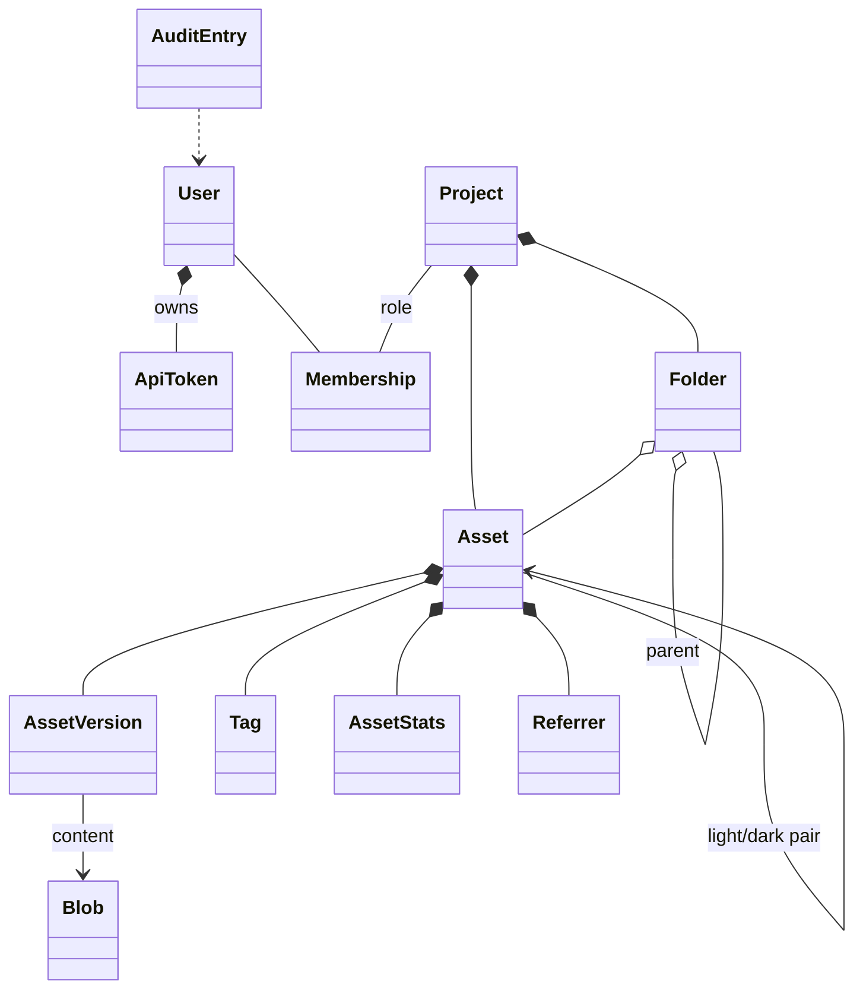

# Crosscutting Concepts

## Domain model

- **Asset** is the unit behind a public link. Its ID never changes and is never reused.
- **AssetVersion** is immutable. Replacing an asset adds a version; restoring copies an old version into a new one.
- **Blob** is file content addressed by its SHA-256. Versions with identical content share a blob.
- **Folder** and **Tag** are pure organization. Neither appears in a link.

The table sketch is in section 8 of the [requirements](../Requirements.md#8-datenmodell-skizze).

## Security

| Concern | Concept |
| --- | --- |
| Authentication | Basic Auth for the UI and API, accepted only when the request is HTTPS, directly or as reported by a trusted proxy. PBKDF2-SHA256 with 600,000 iterations; because Basic Auth sends the password with every request, a verified password is remembered for five minutes in memory, keyed by a hash of user, stored hash and password. Locked users are rejected on the next request. Personal API tokens (shown once, stored as hash, scoped, expiring) for tools from M8. Later: session login, passkeys, OIDC. |
| Authorization | Every endpoint checks the caller's project role (Viewer, Editor, Owner) or admin flag in one place before the use case runs. The permission matrix is in section 4.2 of the requirements. |
| Public links | Capability URLs: unauthenticated, but with random IDs of at least 10 base62 characters; 404s are rate limited to make guessing pointless. |
| Uploads | Type from content, not from the name; size and pixel limits before decoding; SVG sanitized on upload; served with `nosniff` and, for SVG, a sandboxing CSP; served only from the public host. |
| Privacy | EXIF and GPS removed from images; statistics keep counts, times and referrer pages only, no IP addresses or user agents; no cookies on the public host. |
| Abuse | Rate limits for sign-in, uploads, the public check endpoint and 404s; quotas per project. |
| Audit | Security-relevant and content-changing actions are written to the audit log. |

## Persistence

- SQLite in WAL mode, accessed with `Microsoft.Data.Sqlite` and hand-written SQL, which works under Native AOT.
- Schema migrations are numbered, applied on start inside a transaction, and never edited after release.
- File content is written once to `blobs/` through a temporary file and an atomic rename, then referenced from the database. A blob is deleted only when no version refers to it any more.
- Derived variants live in `variants/` and are a cache: deleting the folder only costs CPU.

## HTTP and caching

- Current-version links: `Cache-Control: public, max-age=300, stale-while-revalidate=86400`, strong ETag per variant. A replaced image reaches readers within minutes.
- Version links `/v<n>/`: `Cache-Control: public, max-age=31536000, immutable`.
- Format negotiation by `Accept` with `Vary: Accept`; only configured widths for `?w=` so the variant cache stays bounded.
- Conditional requests (`If-None-Match`, `If-Modified-Since`), `HEAD` and `Range` are supported.

## Image processing

NetVips runs with the libvips operation cache disabled and limited concurrency. A semaphore bounds parallel image jobs so that memory stays predictable. Orientation is applied before metadata is stripped; the ICC profile is kept. AVIF is never encoded on the request path. Details and measurements are in the [NetVips AOT spike](NetVips-AOT-Spike.md).

## Errors and validation

API errors are `application/problem+json` with a stable `type` URI per error kind (for example quota exceeded, unsupported type). Validation happens at the API boundary; the core raises domain errors that the API maps to status codes. Unexpected errors are logged with a correlation ID that the problem details show.

## Configuration

Settings come from `appsettings.json` and `MDU_ASSETS_*` environment variables, bound with the configuration source generator. `appsettings.json` is read from the program folder, wherever the program is started. The data directory is prepared and the migrations run before the server accepts requests; an unusable data directory, a changed migration or a database from a newer version stops the start. Later, the server also refuses to start with incomplete or contradicting settings (for example the same host for UI and public links in production) and says which setting is wrong.

## Observability

- Logs go to stdout as one JSON object per line (single-line text in the `Development` environment).
- One log line per request with method, path, status and duration. The query string is never logged, so tokens in it cannot leak; ASP.NET Core's own request logs are kept at `Warning` for the same reason.
- `/healthz` reports whether the database answers.

## User interface

- Embedded static files, plain JavaScript modules, no build step; the UI uses only the public JSON API.
- Design tokens from MDU (`tokens.css`), light, dark and automatic mode, MDU components such as header, sidebar tree, tiles and callouts.
- Keyboard focus only on `:focus-visible` with the MDU outline; full keyboard operation; a live region announces upload results and copy confirmations; reduced motion respected.

## Testing

Tests use xUnit v3 on Microsoft Testing Platform: `dotnet test --solution MduAssets.slnx` in `Source`, where `global.json` selects the SDK and the test runner.

| Level | Scope |
| --- | --- |
| Unit | Core use cases, permission matrix, ID generation, snippet building, migrations, blob store |
| Integration | HTTP tests against the host with a temporary data directory and SQLite file; upload, delivery, caching headers, roles |
| Native | CI publishes the server and the spike with Native AOT on every target and starts them; Docker images are built and started on native amd64 and arm64 runners |
| UI | Keyboard and focus checks in a served instance before a UI change is merged |
