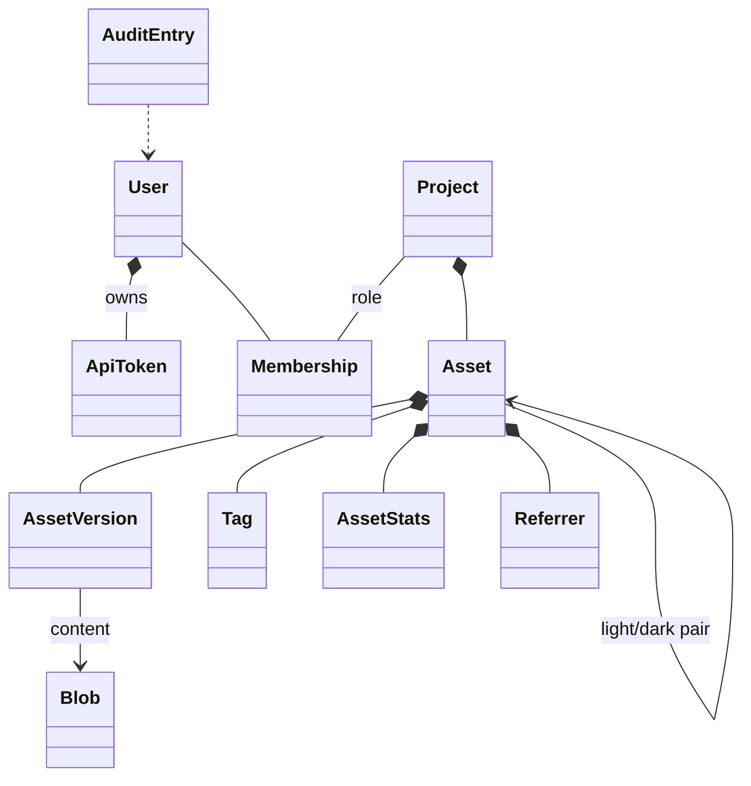

# Crosscutting Concepts

## Domain model

- **Asset** is the unit behind a public link. Its ID never changes and is never reused.
- **AssetVersion** is immutable. Replacing an asset adds a version; restoring copies an old version into a new one.
- **Blob** is file content addressed by its SHA-256. Versions with identical content share a blob.
- **Tag** is pure organization: an asset can have several, and none appears in a link. Tags replaced folders ([ADR-0020](Architecture-Decisions/0020-Tags-Instead-of-Folders.md)).

The table sketch is in section 8 of the [requirements](../Requirements.md#8-datenmodell-skizze).

## Security

| Concern | Concept |
| --- | --- |
| Authentication | Browsers sign in on `/login` and get a session cookie (AUTH-01, AUTH-09, [ADR-0021](Architecture-Decisions/0021-Sign-In-Page-and-Session-Cookie.md)): `__Host-mdu-assets-session`, encrypted with data protection, `HttpOnly`, `Secure`, `SameSite=Strict`, ending with the browser or, with "Stay signed in", after 14 days without use. Every request reads the user again; a lock, a deletion or a changed password ends all sessions of that user, while a password change keeps the session it was made in. Tools send Basic credentials or a token; Basic credentials count only from tools (no `Sec-Fetch-Site`), so credentials a browser remembers from before are ignored. A 401 never carries `WWW-Authenticate`. Passwords are accepted only over HTTPS, directly or as reported by a trusted proxy. PBKDF2-SHA256 with 600,000 iterations; because Basic credentials come with every request, a verified password is remembered for five minutes in memory, keyed by a hash of user, stored hash and password. Personal API tokens for tools (AUTH-06, AUTH-07): `mdua_` and 40 random base62 characters, shown once and stored as SHA-256 (enough for random secrets), named, expiring after 90 days unless chosen otherwise, optionally limited to one project and to reading; sent as `Authorization: Bearer`. A token never has more rights than its user: a project token sees no other project, a read token acts as viewer, and an admin's token keeps admin rights only when it is unlimited. Requests with a token cannot manage tokens, change the password or use the admin area (`PasswordOnly`), so a leaked token cannot take over the account. Last use is recorded at most once a minute. Later: passkeys, OIDC. |
| Authorization | Every project endpoint asks `ProjectAccess` for the caller's role before it acts: viewers read and copy, editors also upload and change images, owners also manage members and the project; admins act as owners everywhere (matrix in section 4.2 of the requirements). Projects the caller cannot see answer 404, so their names do not leak; too little rights answer 403. User management, settings and the overview need the admin role. A project keeps at least one owner, and the instance at least one unlocked admin; both are checked inside the database transaction that makes the change. |
| Start passwords | Admins never choose passwords for others: creating a user or resetting a password generates a 16-character start password, shown once and stored only as a hash. Until the user replaces it, every API request except `GET /api/v1/me` and `POST /api/v1/me/password` answers 403 with the problem type `urn:mdu-assets:problem:password-change-required`. Changing a password needs the current one. |
| Public links | Capability URLs: unauthenticated, but with random IDs of at least 10 base62 characters; 404s are rate limited to make guessing pointless. |
| Web interface | Served only on the UI host and only to signed-in users. A strict content security policy allows scripts, styles and requests only from the UI host itself and images also from the public host; no inline scripts or styles, no framing. |
| Cross-site requests | Browsers send the session cookie only with requests from the UI itself (`SameSite=Strict`); in addition, every request other than `GET`, `HEAD` and `OPTIONS` is rejected with 403 when `Sec-Fetch-Site` is neither `same-origin` nor `none`, or when `Origin` is not the UI origin. Tools such as curl send neither header. |
| Data protection keys | ASP.NET Core keeps its keys in `keys/` in the data directory, readable only by the server user and not encrypted; they protect the session cookies. `mdu-assets backup` leaves them out, so a stolen backup cannot make session cookies; a restored instance makes new keys and everybody signs in again ([ADR-0021](Architecture-Decisions/0021-Sign-In-Page-and-Session-Cookie.md)). |
| Uploads | Type from content, not from the name; size and pixel limits before decoding; SVG sanitized on upload; served with `nosniff` and, for SVG, a sandboxing CSP; served only from the public host. |
| Privacy | EXIF and GPS removed from images; statistics keep counts, times and referrer pages only, no IP addresses or user agents; no cookies on the public host. |
| Public link check | `POST /api/v1/public/check` answers without signing in for up to 100 links with `ok`, `trash`, `deleted`, `unknown` or `invalid` and nothing else (API-06); limited to 60 requests per minute and client address. |
| Abuse | Failed sign-ins: after 10 within 15 minutes per user name or per address (`MDU_ASSETS_SIGNINFAILURES`), further tries get 429 with `Retry-After`, on the sign-in page and for Basic credentials, before any password is checked (AUTH-08). Uploads, new versions and imports: 60 per minute and user (`MDU_ASSETS_UPLOADSPERMINUTE`). Public check: 60 per minute and address. Public links: after 100 answers 404 per minute and address (`MDU_ASSETS_PUBLICNOTFOUNDPERMINUTE`), 429 for a minute, so ids cannot be guessed. Counters are kept in memory. Sizes: the upload limit of the instance, lower per project if owners want (OPS-01); a storage quota per project set by admins, counting every version and the trash but no variants, with a warning in the interface from 90 % (OPS-02). |
| Audit | `AuditLog` records every successful change through the API in one place (uploads, versions, moves, renames, metadata, trash, members, tokens, users, settings, imports) and the authentication handler records sign-ins (when a password is really checked, not from the cache) and failed sign-ins: time, user, project, action, target, details and client address (OPS-03). Admins see everything, owners the log of their project without addresses. Entries are kept 365 days (`MDU_ASSETS_AUDITRETENTIONDAYS`). |

## Persistence

- SQLite in WAL mode, accessed with `Microsoft.Data.Sqlite` and hand-written SQL, which works under Native AOT.
- Schema migrations are numbered, applied on start inside a transaction, and never edited after release.
- File content is written once to `blobs/` through a temporary file and an atomic rename, then referenced from the database. A blob is deleted only when no version refers to it any more.
- Derived variants live in `variants/` and are a cache: deleting the folder only costs CPU.

## HTTP and caching

- Current-version links: `Cache-Control: public, max-age=300, stale-while-revalidate=86400`, strong ETag per variant. A replaced image reaches readers within minutes.
- Version links `/i/<id>/v<n>/<name>`: `Cache-Control: public, max-age=31536000, immutable`; every version keeps its link until it is deleted. Assets in the trash, or deleted for good, answer `410 Gone`; unknown ids `404`.
- No format negotiation: a link always serves the format chosen on upload ([ADR-0019](Architecture-Decisions/0019-Format-Chosen-on-Upload.md)), so its extension and `Content-Type` match and answers do not vary by `Accept`. `?w=` snaps to configured widths, so the variant cache stays bounded. ETags differ per width.
- Conditional requests (`If-None-Match`, `If-Modified-Since`), `HEAD` and `Range` are supported.

## Image processing

NetVips runs with the libvips operation cache disabled and limited threads per operation. `ImageJobs` bounds parallel image jobs (half the processors by default, `MDU_ASSETS_IMAGEJOBS`) so that memory stays predictable. Uploads with EXIF, XMP, IPTC or PNG comments, or with an orientation, are re-encoded once with the orientation applied and the ICC profile kept; all others keep their exact bytes. Right after that, `ImageProcessor.ToWebP` decides the format to serve: JPEG becomes lossy WebP (quality 82); PNG, BMP and still GIF lossless WebP unless that is more than twice the lossy size (photographic content), kept only when smaller; `?lossless=true` never loses quality. Only the result is stored; the upload's type and size are recorded ([ADR-0019](Architecture-Decisions/0019-Format-Chosen-on-Upload.md)). Previews (480 pixels, WebP) are made on upload, `?w=` widths on first use, both kept in `variants/`; requests for the same missing variant wait for one job. Width rules are in [ADR-0015](Architecture-Decisions/0015-Image-Variant-Rules.md). Details and measurements are in the [NetVips AOT spike](NetVips-AOT-Spike.md).

## Errors and validation

The API is described as OpenAPI 3.1 at `/api/v1/openapi.json` (API-02), generated by ASP.NET Core from the endpoints and served without signing in; public links and the web interface are not part of it. API errors are `application/problem+json` with a stable `type` URI per error kind (for example quota exceeded, unsupported type). Validation happens at the API boundary; the core raises domain errors that the API maps to status codes. Unexpected errors are logged with a correlation ID that the problem details show.

## Configuration

Settings come from `appsettings.json` and `MDU_ASSETS_*` environment variables, bound with the configuration source generator. `appsettings.json` is read from the program folder, wherever the program is started. The data directory is prepared and the migrations run before the server accepts requests; an unusable data directory, a changed migration or a database from a newer version stops the start. Later, the server also refuses to start with incomplete or contradicting settings (for example the same host for UI and public links in production) and says which setting is wrong.

## Observability

- Logs go to stdout as one JSON object per line (single-line text in the `Development` environment).
- One log line per request with method, path, status and duration. The query string is never logged, so tokens in it cannot leak; ASP.NET Core's own request logs are kept at `Warning` for the same reason.
- `/healthz` reports whether the database answers.

## User interface

- Embedded static files, plain JavaScript modules, no build step; the UI uses only the public JSON API. API URLs are built from `location.origin`, because a page opened with credentials in the URL would otherwise make `fetch()` refuse every relative request.
- Design tokens from MDU (`tokens.css`, unchanged copy checked against `tokens.pin.json`), light, dark and automatic mode with the MDU theme switch (stored as `mdu-theme`, restored before the first paint), MDU components: sticky glass header, sidebar, cards like tag cards, tables without vertical lines, one filled button for the main action.
- Quiet controls, as in MDU and its design system ("Steuerelemente"): tool buttons rest in `--control-rest` and light up in `--control-current` when they are open or chosen, with `--control-current-fill` behind open menus and chosen segments. That covers the theme switch, the user name with its menu, the view switch, the preview backgrounds and the ⋯ next to tags; content, dialog and form buttons stay bright. With "Increase contrast" in the system, `--control-rest` is the primary tone.
- Uploads: drop anywhere (an overlay names the target project), paste anywhere outside text fields (pasted images get `screenshot-<date>-<time>` and the alt text "Screenshot"), or the file picker. `XMLHttpRequest` reports progress per file. After the upload, the snippet is copied when the browser allows it; otherwise focus moves to its Copy button.
- Snippets: Markdown, URL or HTML (choice remembered); file name and alt text are edited in place and saved on Enter or when leaving the field, one save at a time per card. Clear removes finished cards and keeps running uploads.
- Organizing (ORG-02 – ORG-04): the sidebar lists the project's tags with their use; each click adds or removes a tag from the filter, and an image must have every chosen tag. Active tags show as chips above the images; "Untagged" shows images without tags; on narrow screens "Add a tag" in the filters does the same. Uploads get the tags the list is filtered by. Images get tags by dragging them onto a tag or with "Tags…" on a selection; the ⋯ next to a tag renames, merges or deletes it in the whole project. Links never change. Tags are free text, compared without case, with suggestions from the project; a tag keeps the spelling the project already uses. Search matches every word in file name, alt text, description or tags; filters cover tags, type, uploader, upload dates and requests. Text and tags compare without case for every alphabet: SQLite's own folding covers only A to Z, so search uses a lower-case function from .NET and tags store a lower-case key. Upload dates are days of the viewer's time zone; the interface sends the exact times (`fromTime`, `beforeTime`). Search and filters live in the address, so a filtered view can be shared.
- Keyboard in the grid (ORG-07): one image is in the tab order; arrow keys, Home and End move between images, Enter opens the details, C copies the Markdown snippet, Space selects.
- Details (ORG-06): `?project=<slug>&asset=<id>` shows a large preview on a checkerboard, light or dark background, all snippets, description, tags and the metadata (type, size, hash, uploader, date, version). Versions, statistics, referring pages and the light/dark partner join this page when they exist (M5 – M7).
- Finding an image by its link (LNK-09): pasting a public link into the search, with or without file name, size parameter or fragment, opens its details through `GET /api/v1/lookup`, if the caller may see the project.
- Versions and trash (VER-01 – VER-04, DEL-01 – DEL-03): a file dropped or pasted on the details page, or chosen with "Replace image", becomes the next version under the same link; a format change is allowed and explained. The version list opens, restores (as a new version) or, for owners, deletes old versions. "Move to trash", the Delete key in the grid and the selection bar move images to the trash after a confirmation; the trash page restores them or, for owners, deletes them for good. `TrashCleanup` deletes trashed images after 30 days (`MDU_ASSETS_TRASHRETENTIONDAYS`); the row stays as a tombstone so ids are never reused, and `BlobCleanup` removes blobs and variants no version uses any more. Destructive dialogs start with the focus on Cancel.
- Statistics (STA-01 – STA-06): `UsageCounter` counts finished public GET requests with 200 or 304 in memory and writes them every 10 seconds (`MDU_ASSETS_STATSFLUSHSECONDS`) and when the server stops. HEAD, known bots (`MDU_ASSETS_BOTUSERAGENTS`) and requests whose `Referer` is the web interface are not counted; widths, formats and version links count as the image. Per asset only the count and the last request are kept, and per referring page its origin, path, count and last request, at most 100 per asset. No IP addresses or user agents are stored. The grid, list and details show the numbers with their limits explained; the filter "Requests" finds images never requested or not in 30, 90 or 365 days (`?unused=`), and moving an image requested in the last 30 days to the trash names its counts and referring pages first (DEL-01).
- Snippets (LNK-05 – LNK-08): built in the browser from the asset. A light and dark pair gives two lines with `#only-light` and `#only-dark` and the same alt text; the switches for `{.image-frame}`, zoom and width are remembered per user in the browser, and a caption on the details page wraps the image in an MDU figure (`^^^`). Uploads named `*-light` and `*-dark` are offered as a pair.
- Duplicates (UP-09): the interface uploads with `?duplicates=reject`; content that is already in the project comes back as 409 with the existing image, and the card offers it or a second copy. API clients without the parameter always get a new asset.
- Image list: the API returns pages of at most 500 assets, newest first (`?limit=` and `?after=<id>`, with `next` in the answer); the interface loads 200 at a time with a "Show more images" button. The project summary counts all images. Previews come from `GET /api/v1/assets/{id}/thumbnail?v=<hash>`: signed in, never counted, cached for good because the hash changes with the content.
- Pages: `?project=<slug>` shows the images of a project, `&page=settings` its settings (owners); `?page=new-project`, `?page=account` and `?page=admin` are the other pages. Controls appear only for callers who may use them: viewers see no upload controls and read-only fields, and with a start password the account page is the only page. The server checks every request again.
- Account menu (AUTH-01): the user name in the header opens a menu with Account, Admin (for admins) and Sign out, following the menu button pattern: Enter, Space or Down open it on the first entry, Up on the last; arrows, Home and End move; Escape closes it and returns to the button.
- Keyboard focus only on `:focus-visible` with the MDU outline (inset where a container clips); a live region announces uploads, saves and copies; reduced motion turns transitions off.

## Testing

Tests use xUnit v3 on Microsoft Testing Platform: `dotnet test --solution MduAssets.slnx` in `Source`, where `global.json` selects the SDK and the test runner.

| Level | Scope |
| --- | --- |
| Unit | Core use cases, permission matrix, ID generation, snippet building, migrations, blob store |
| Integration | HTTP tests against the host with a temporary data directory and SQLite file; upload, delivery, caching headers, roles |
| Native | CI publishes the server and the spike with Native AOT on every target and starts them; Docker images are built and started on native amd64 and arm64 runners |
| UI | Keyboard and focus checks in a served instance before a UI change is merged |
