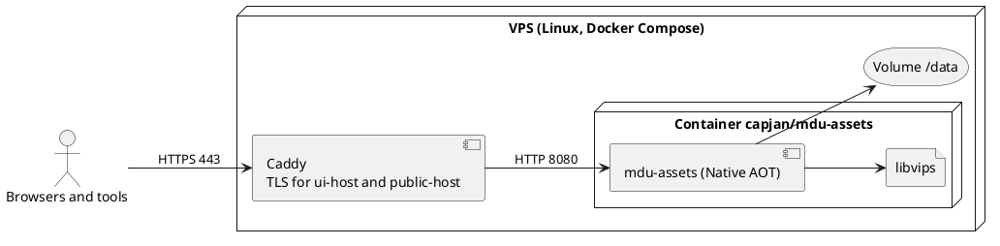

# Deployment View

Step-by-step instructions for this setup are in the [deployment guide](../Deployment.md).

## Reference installation: VPS with Docker

The first production instance runs on a VPS with Docker Compose. A reverse proxy (Caddy in the reference setup) terminates TLS for two host names and forwards both to the same container.



| Element | Description |
| --- | --- |
| Reverse proxy | Obtains certificates, forwards both host names, sets `X-Forwarded-*`. The server trusts only configured proxy addresses. |
| Container | Image based on `runtime-deps` chiseled, non-root user, the AOT program; libvips joins with image processing (M5). Built per architecture on native runners. |
| Volume `/data` | All state of the instance. Nothing else needs a backup. |
| Configuration | Environment variables `MDU_ASSETS_*`, see the table below, and the standard `ASPNETCORE_HTTP_PORTS` (`8080` in the image). The server checks them on start and stops with a message that names the wrong setting. |
| Health check | `GET /healthz` answers `Healthy` when the database answers. The chiseled image has no shell or curl, so container health checks run from outside, for example from the reverse proxy or monitoring. |

The host names are configuration; the documentation uses `assets.example.com` for the UI and `img.example.com` for public links as placeholders.

| Variable | Default | Meaning |
| --- | --- | --- |
| `MDU_ASSETS_UIBASEURL` | required (development: `http://127.0.0.1:5180`) | Base URL of the web interface and the API |
| `MDU_ASSETS_PUBLICBASEURL` | required (development: `http://127.0.0.1:5181`) | Base URL of public links; must use another host than the UI |
| `MDU_ASSETS_ADMIN_USER`, `MDU_ASSETS_ADMIN_PASSWORD` | required while there are no users | First administrator; the password needs at least 12 characters. Ignored once users exist |
| `MDU_ASSETS_DATADIRECTORY` | `data` (image: `/data`) | Folder for the database and files |
| `MDU_ASSETS_TRUSTEDPROXIES` | loopback only | Comma-separated addresses or networks of reverse proxies whose `X-Forwarded-For` and `X-Forwarded-Proto` are trusted, for example `172.16.0.0/12` for a proxy in another container |
| `MDU_ASSETS_ALLOWHTTP` | `false` | Accept passwords over plain HTTP; only for development and tests |
| `MDU_ASSETS_MAXUPLOADBYTES` | `20971520` (20 MB) | Largest upload |
| `MDU_ASSETS_MAXPIXELS` | `50000000` | Largest image in pixels, checked before decoding |
| `MDU_ASSETS_PUBLICMAXAGESECONDS`, `MDU_ASSETS_PUBLICSTALEWHILEREVALIDATESECONDS` | `300`, `86400` | Caching of public links |

## Data directory

```text
/data
├── mdu-assets.db         # SQLite database (WAL mode): users, projects, assets, versions, statistics, audit log
├── blobs/ab/cd/<sha256>  # content of every version, written once
├── variants/…            # resized and converted variants, can be deleted at any time
├── keys/                 # ASP.NET Core data protection keys, readable only by the server user
└── tmp/                  # uploads in progress
```

## Backup and restore

`mdu-assets backup <target>` writes a consistent copy of the database and the blobs. Where the copy goes (storage box, snapshot, other host) is the operator's choice. `variants/` and `tmp/` are not needed for a restore.

## Other ways to run

| Option | Notes |
| --- | --- |
| Native binary | Archive with the program, libvips and license texts for linux-x64, linux-arm64 and osx-arm64; macOS builds signed and notarized. |
| Local development | `dotnet run --project MduAssets` in `Source` serves the web interface and API on `http://127.0.0.1:5180` and public links on `http://127.0.0.1:5181`, keeps its data in `Source/MduAssets/data/` (ignored by Git), allows HTTP and creates the user `admin` with the password `development-only`. |
| Image build | `docker build -t mdu-assets .` in `Source` builds for the architecture of the Docker host. |
