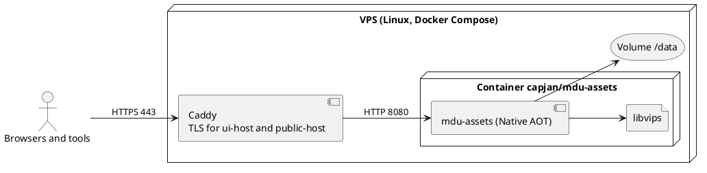

# Deployment View

## Reference installation: VPS with Docker

The first production instance runs on a VPS with Docker Compose. A reverse proxy (Caddy in the reference setup) terminates TLS for two host names and forwards both to the same container.



| Element | Description |
| --- | --- |
| Reverse proxy | Obtains certificates, forwards both host names, sets `X-Forwarded-*`. The server trusts only configured proxy addresses. |
| Container | Image based on `runtime-deps` chiseled, non-root user, the AOT program and libvips. Built per architecture on native runners. |
| Volume `/data` | All state of the instance. Nothing else needs a backup. |
| Configuration | Environment variables `MDU_ASSETS_*`: UI base URL, public base URL, trusted proxies, limits, first admin. |

The host names are configuration; the documentation uses `assets.example.com` for the UI and `img.example.com` for public links as placeholders.

## Data directory

```text
/data
├── mdu-assets.db         # SQLite database (WAL mode): users, projects, assets, versions, statistics, audit log
├── blobs/ab/cd/<sha256>  # content of every version, written once
├── variants/…            # resized and converted variants, can be deleted at any time
└── tmp/                  # uploads in progress
```

## Backup and restore

`mdu-assets backup <target>` writes a consistent copy of the database and the blobs. Where the copy goes (storage box, snapshot, other host) is the operator's choice. `variants/` and `tmp/` are not needed for a restore.

## Other ways to run

| Option | Notes |
| --- | --- |
| Native binary | Archive with the program, libvips and license texts for linux-x64, linux-arm64 and osx-arm64; macOS builds signed and notarized. |
| Local development | `dotnet run` with a data directory in the working folder and `127.0.0.1` for both host names on different ports. |
