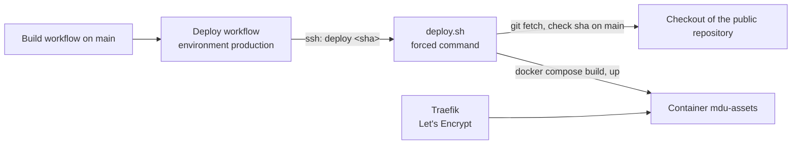
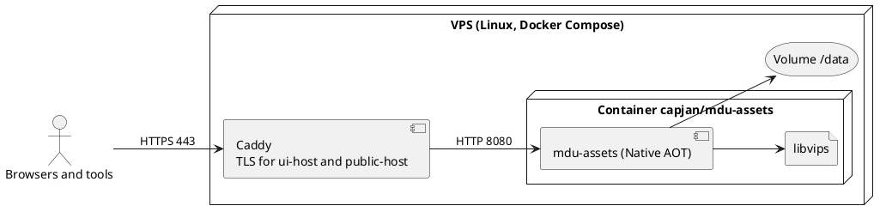
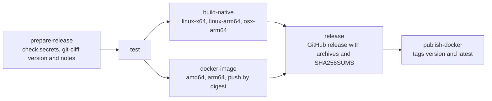

# Deployment View

Step-by-step instructions for this setup are in the [deployment guide](../Deployment.md).

## Reference installation: VPS with Docker

The first production instance runs on a VPS with Docker Compose. A reverse proxy (Caddy in the reference setup) terminates TLS for two host names and forwards both to the same container.

The production instance serves its two host names (UI and public links) behind the server's existing Traefik, which also serves other sites; the host names are set on the server only ([`Deploy/traefik`](https://github.com/capjan/mdu-assets/tree/main/Deploy/traefik)). Every successful build of `main` is deployed by the workflow `deploy.yml`: an SSH key restricted to a forced command makes the server build and start that commit from its own checkout of the public repository ([deployment guide](../Deployment.md#automatic-deployment-from-github)).





| Element | Description |
| --- | --- |
| Reverse proxy | Obtains certificates, forwards both host names, sets `X-Forwarded-*`. The server trusts only configured proxy addresses. |
| Container | Image based on `runtime-deps` chiseled, non-root user, the AOT program and libvips (`libvips.so.42`, about 18 MB, from NetVips.Native) next to it. Built per architecture on native runners. |
| Volume `/data` | All state of the instance. Nothing else needs a backup. |
| Configuration | Environment variables `MDU_ASSETS_*`, see the table below, and the standard `ASPNETCORE_HTTP_PORTS` (`8080` in the image). The server checks them on start and stops with a message that names the wrong setting. |
| Health check | `GET /healthz` answers `Healthy` when the database answers. The chiseled image has no shell or curl, so container health checks run from outside, for example from the reverse proxy or monitoring. |

The host names are configuration; the documentation uses `assets.example.com` for the UI and `img.example.com` for public links as placeholders.

| Variable | Default | Meaning |
| --- | --- | --- |
| `MDU_ASSETS_UIBASEURL` | required (development: `http://127.0.0.1:5180`) | Base URL of the web interface and the API |
| `MDU_ASSETS_PUBLICBASEURL` | required (development: `http://127.0.0.1:5181`) | Base URL of public links; must use another host than the UI |
| `MDU_ASSETS_ADMIN_USER`, `MDU_ASSETS_ADMIN_PASSWORD` | required while there are no users | First administrator; the password needs at least 12 characters. Ignored once users exist |
| `MDU_ASSETS_DATADIRECTORY` | `data` (image: `/data`) | Folder for the database and files |
| `MDU_ASSETS_TRUSTEDPROXIES` | loopback only | Comma-separated addresses or networks of reverse proxies whose `X-Forwarded-For` and `X-Forwarded-Proto` are trusted, for example `172.16.0.0/12` for a proxy in another container |
| `MDU_ASSETS_ALLOWHTTP` | `false` | Accept passwords over plain HTTP; only for development and tests |
| `MDU_ASSETS_MAXUPLOADBYTES` | `52428800` (50 MB) | Largest upload; only the converted file is stored |
| `MDU_ASSETS_MAXPIXELS` | `50000000` | Largest image in pixels, checked before decoding |
| `MDU_ASSETS_PUBLICMAXAGESECONDS`, `MDU_ASSETS_PUBLICSTALEWHILEREVALIDATESECONDS` | `300`, `86400` | Caching of public links |
| `MDU_ASSETS_SIGNINFAILURES` | `10` | Failed sign-ins per user or address within 15 minutes before further tries get 429 |
| `MDU_ASSETS_UPLOADSPERMINUTE` | `60` | Uploads, new versions and imports per user and minute |
| `MDU_ASSETS_PUBLICNOTFOUNDPERMINUTE` | `100` | 404 answers on public links per address and minute before 429 |
| `MDU_ASSETS_AUDITRETENTIONDAYS` | `365` | Days audit entries are kept |
| `MDU_ASSETS_MAXIMPORTBYTES` | `2147483648` (2 GB) | Largest project export accepted for import |
| `MDU_ASSETS_STATSFLUSHSECONDS` | `10` | How often counted requests are written to the database |
| `MDU_ASSETS_BOTUSERAGENTS` | `bot,crawl,spider,…` | Comma-separated parts of user agents whose requests are not counted |
| `MDU_ASSETS_TRASHRETENTIONDAYS` | `30` | Days an asset stays in the trash before it is deleted for good |
| `MDU_ASSETS_WIDTHS` | `320,640,800,1024,1280,1600,2048` | Widths `?w=` may ask for; others snap to the next larger one |
| `MDU_ASSETS_THUMBNAILSIZE` | `480` | Longer side of previews in the web interface |
| `MDU_ASSETS_IMAGEJOBS` | half the processors | Image jobs (cleaning, previews, widths, conversion) at the same time |

## Data directory

```text
/data
├── mdu-assets.db         # SQLite database (WAL mode): users, projects, assets, versions, statistics, audit log
├── blobs/ab/cd/<sha256>  # content of every version, written once
├── variants/…            # resized and converted variants, can be deleted at any time
├── keys/                 # ASP.NET Core data protection keys, readable only by the server user
└── tmp/                  # uploads in progress
```

## Backup and restore

`mdu-assets backup <target>` writes a consistent copy of the database (SQLite online backup) and the blobs it refers to, also while the server runs, but not the keys `keys/`, so a copy cannot make session cookies; the [deployment guide](../Deployment.md#backup) shows it for Docker. Where the copy goes (storage box, snapshot, other host) is the operator's choice. `variants/` and `tmp/` are not needed for a restore.

## Other ways to run

| Option | Notes |
| --- | --- |
| Native binary | Archive `mdu-assets-<version>-<rid>.tar.gz` for linux-x64, linux-arm64 and osx-arm64 with a folder that holds the program, its native libraries (`libvips`, `libe_sqlite3`), `appsettings.json`, the README, the license and the third-party license texts. Run `mdu-assets` from that folder. The macOS program and libraries are signed and notarized. |
| Local development | `dotnet run --project MduAssets` in `Source` serves the web interface and API on `http://127.0.0.1:5180` and public links on `http://127.0.0.1:5181`, keeps its data in `Source/MduAssets/data/` (ignored by Git), allows HTTP and creates the user `admin` with the password `development-only`. |
| Image build | `docker build -t mdu-assets .` in `Source` builds for the architecture of the Docker host. |

## Build and release pipeline

Four GitHub Actions workflows check, ship and deploy the server. All builds run on native runners, never under emulation.

| Workflow | Trigger | What it does |
| --- | --- | --- |
| CI (`ci.yml`) | Every pull request and push to `main` | Checks Conventional Commit messages and lints `Docs` with `mdu lint` |
| Build (`build.yml`) | Changes under `Source/` | Tests, publishes the Native AOT program for each target and smoke-tests it, builds and smoke-tests the Docker image for amd64 and arm64, runs the NetVips spike |
| Release (`release.yml`) | Started manually from `main` | Publishes a version, see below |
| Deploy (`deploy.yml`) | Every successful Build run on `main` | Deploys that commit to the production instance, see above; independent of releases |

The release workflow runs these jobs:



- git-cliff calculates the version from the Conventional Commits since the last `v*` tag (`Source/cliff.toml`; the first release is `v0.1.0`) and writes the release notes. The version goes into the program (`-p:Version`) and the image (`VERSION` build argument and OCI labels).
- Each archive is extracted again and smoke-tested with `Source/smoke-test.sh`, after signing and notarization on macOS; each image is smoke-tested before it is pushed.
- Images are pushed by digest and get the tags `capjan/mdu-assets:<version>` and `latest` only after the GitHub release is published, so a failed run leaves no tag behind. "Re-run failed jobs" resumes a run with the same version.
- Secrets and variables: the Apple signing and notarization settings and the Docker Hub token as in MDU, listed in [AGENTS.md](https://github.com/capjan/mdu-assets/blob/main/AGENTS.md). The first job checks them before anything is built.
