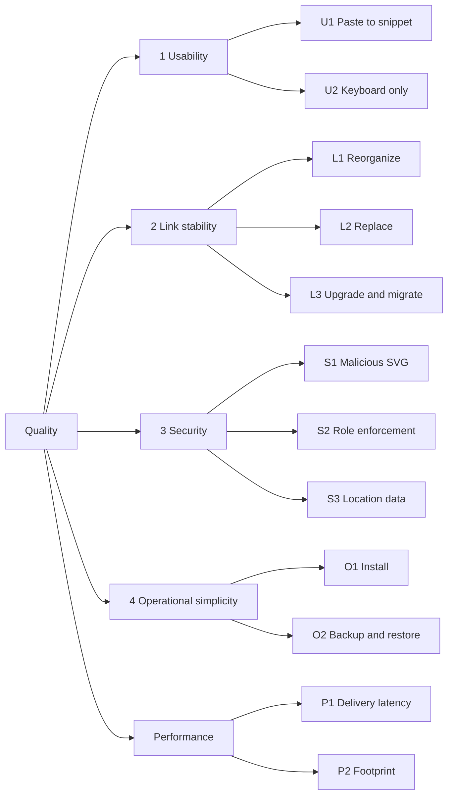

# Quality Requirements

## Quality tree

## Quality scenarios

| ID | Scenario | Expected response |
| --- | --- | --- |
| U1 | An author pastes a screenshot into the project view. | The Markdown snippet is shown and, where the browser allows, copied within 2 s on a normal connection, without further input. |
| U2 | An author uses only the keyboard. | Upload by paste, selecting an asset, copying its snippet and tagging it work without a mouse, with a visible MDU focus ring on every step. |
| L1 | An editor changes the tags of an asset and renames a tag and the project. | The previously copied link returns the same image. |
| L2 | An editor replaces an image. | The link returns the new image after at most the configured cache time; the old version stays reachable under its version link. |
| L3 | The operator upgrades the server or moves a project to another instance by export and import. | Every existing link keeps working (on the new instance, with the same public host). |
| S1 | A user uploads an SVG with script, event handlers and external references. | The stored file contains none of them; opening the public link directly runs no script. |
| S2 | A viewer or a read-only token calls the upload endpoint. | `403`, nothing stored, the attempt is in the audit log. |
| S3 | An author uploads a phone photo with GPS data. | The stored and served file has no EXIF or GPS data and the correct orientation. |
| O1 | An operator installs the server on a new VPS. | Docker Compose file, two host names and two environment variables for the first admin are enough; the server runs in under 15 minutes. |
| O2 | The VPS is lost. | A backup made with the backup command restores all links and metadata on a new host. |
| P1 | A reader requests a cached image. | p95 under 20 ms server time on a small VPS. |
| P2 | The server is idle. | Under 80 MB memory, cold start under 200 ms. |

## Measured performance

P1 and P2 were measured for release 1.0 (NF-07) on the release image `linux/arm64`, limited to one CPU and 1 GB memory with `--cpus 1 --memory 1g`, on an Apple M4 under Docker. A small VPS has a slower CPU, so expect higher numbers there; the margins below leave room for that.

| Target | Measured | Result |
| --- | --- | --- |
| Public link p95 under 20 ms server time | p50 0.18 ms, p95 1.09 ms, p99 1.65 ms over 15,000 requests (full size, `?w=800` and `304 Not Modified`); the slowest, 161 ms, made the `?w=800` copy once | Met |
| Cold start under 200 ms | 104 ms from container start to "Application started" with an existing database; 225 ms on the very first start, which creates the database and hashes the administrator's password | Met |
| Idle memory under 80 MB | 20 MB after the start; 59 MB idle after an upload of a 3 MB PNG (1536 × 1024) and 15,000 requests | Met |

Server time comes from the request log (`ElapsedMs`); `ab` with four parallel connections measured 6 ms p95 for a 530 KB image including Docker's network on macOS, and 1 ms for `304` answers.

Memory first missed the target: after one upload the idle server kept about 140 MB. libvips works in many threads, glibc gives threads their own malloc arenas, and it rarely returns freed memory from them. The server now limits glibc to two arenas at start and returns free native memory when the last running image job ends (`GlibcMemory`, `ImageJobs`). `MALLOC_ARENA_MAX` in the environment still overrides the limit.

How to repeat it: start the image with the limits above, upload a large PNG, send 5,000 requests each to its link, to `?w=800` and with `If-None-Match`, then read `RssAnon` of the process from `/proc/<pid>/status` and the `ElapsedMs` values of the request log.
