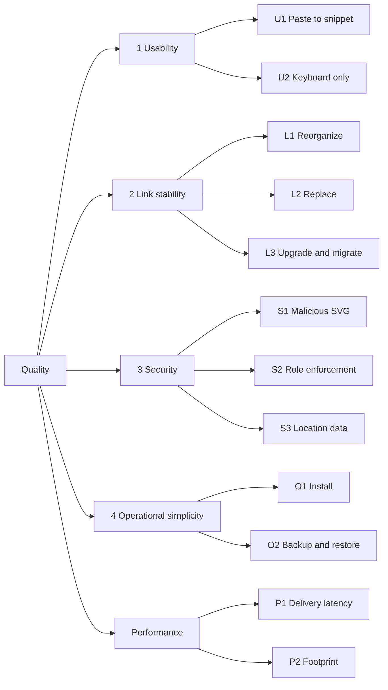

# Quality Requirements

## Quality tree

## Quality scenarios

| ID | Scenario | Expected response |
| --- | --- | --- |
| U1 | An author pastes a screenshot into the project view. | The Markdown snippet is shown and, where the browser allows, copied within 2 s on a normal connection, without further input. |
| U2 | An author uses only the keyboard. | Upload by paste, selecting an asset, copying its snippet and moving it to another folder work without a mouse, with a visible MDU focus ring on every step. |
| L1 | An editor moves an asset to another folder and renames the folder and the project. | The previously copied link returns the same image. |
| L2 | An editor replaces an image. | The link returns the new image after at most the configured cache time; the old version stays reachable under its version link. |
| L3 | The operator upgrades the server or moves a project to another instance by export and import. | Every existing link keeps working (on the new instance, with the same public host). |
| S1 | A user uploads an SVG with script, event handlers and external references. | The stored file contains none of them; opening the public link directly runs no script. |
| S2 | A viewer or a read-only token calls the upload endpoint. | `403`, nothing stored, the attempt is in the audit log. |
| S3 | An author uploads a phone photo with GPS data. | The stored and served file has no EXIF or GPS data and the correct orientation. |
| O1 | An operator installs the server on a new VPS. | Docker Compose file, two host names and two environment variables for the first admin are enough; the server runs in under 15 minutes. |
| O2 | The VPS is lost. | A backup made with the backup command restores all links and metadata on a new host. |
| P1 | A reader requests a cached image. | p95 under 20 ms server time on a small VPS. |
| P2 | The server is idle. | Under 80 MB memory, cold start under 200 ms. |
