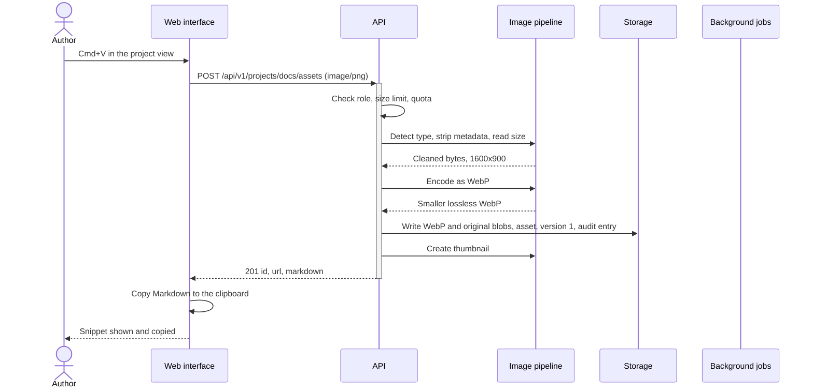
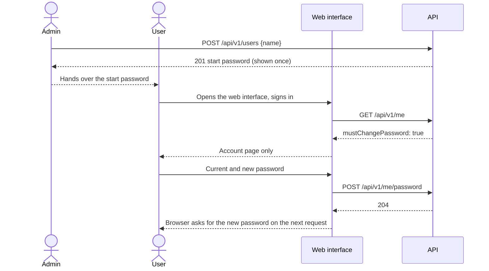
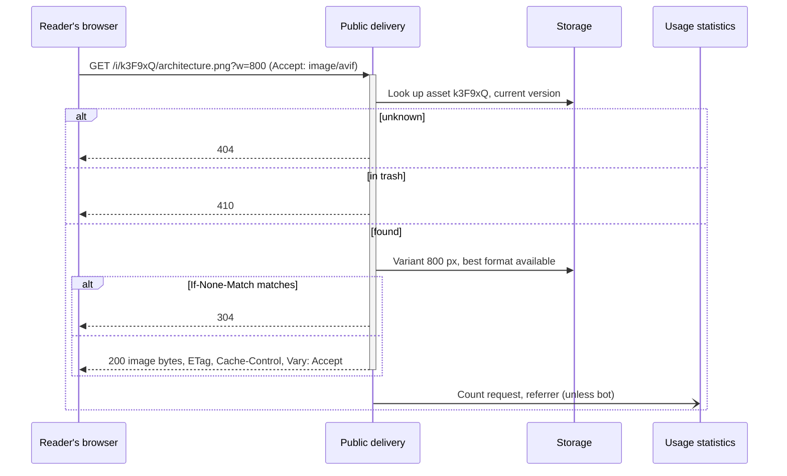
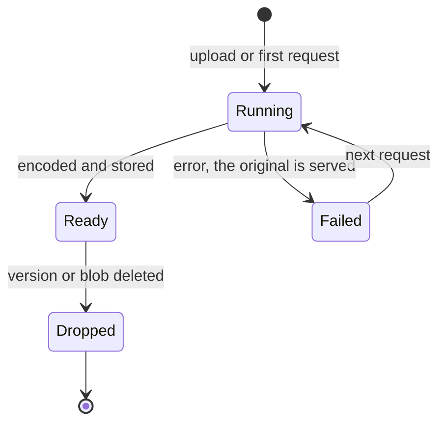

# Runtime View

## Paste a screenshot and copy the snippet

The upload answers as soon as the image in its chosen format, the kept original and the thumbnail are stored; the snippet already carries the `.webp` name ([ADR-0019](Architecture-Decisions/0019-Format-Chosen-on-Upload.md)).

> [!NOTE]
> Since M9 the sequence runs as shown.

## First sign-in with a start password

Until the password is changed, every other API request answers 403, so a tool cannot work around the account page.

## Serve a public link

The file name in the URL is ignored for the lookup, so old links still work after a rename. Statistics are recorded after the response is on its way and written to SQLite in batches.

## Replace an image

1. An editor drops a new file on the asset details.
2. The image pipeline cleans it as on upload; storage writes a new blob and version 2 and points the asset at it.
3. Variants of version 1 stay for its version link ([ADR-0016](Architecture-Decisions/0016-Version-Retention-and-Cache-Purging.md)); version 2 is converted like an upload, gets its own preview at once and widths on demand; if its format differs, the asset gets the new extension. With a version limit set for the project, versions beyond it are deleted for good, and blobs no version uses any more go with their variants.
4. The public link serves version 2 once the readers' caches expire (`max-age=300`). Version 1 stays reachable under `/i/<id>/v1/<name>` and can be restored as version 3.

## Background work

Background services delete trashed assets after the retention period, clean up old audit entries and write request statistics. Image work runs in the request that needs it, bounded by `ImageJobs`; missing variants are made again when requested.
