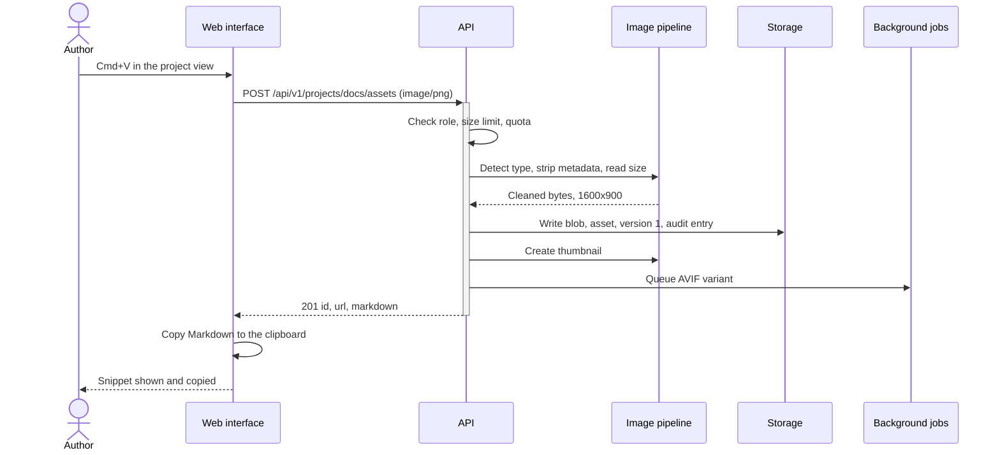
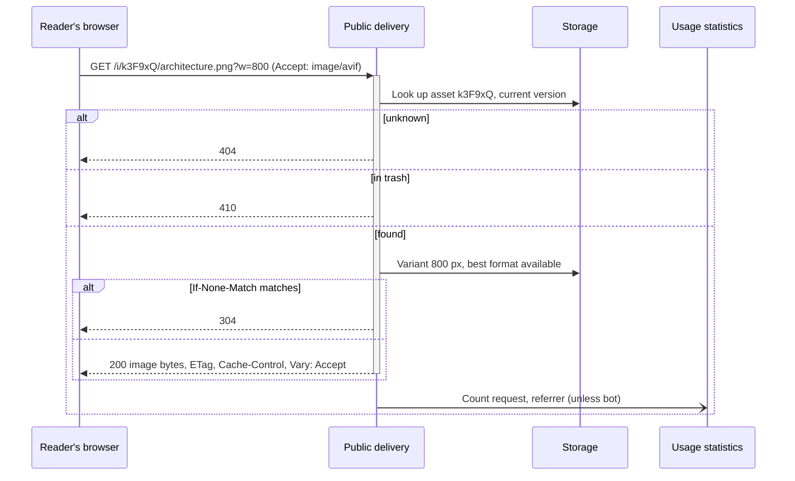
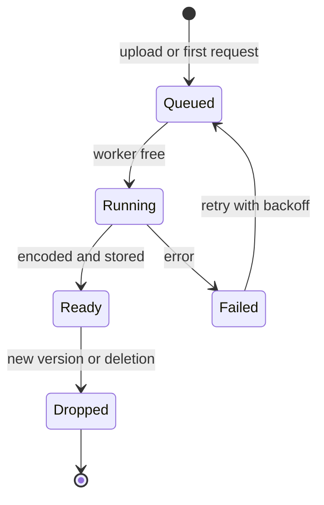

# Runtime View

## Paste a screenshot and copy the snippet

The upload answers as soon as the original, its metadata and the thumbnail are stored. The AVIF variant follows in the background ([ADR-0011](Architecture-Decisions/0011-AVIF-in-the-Background.md)).

## Serve a public link

The file name in the URL is ignored for the lookup, so old links still work after a rename. Statistics are recorded after the response is on its way and written to SQLite in batches.

## Replace an image

1. An editor drops a new file on the asset details.
2. The image pipeline cleans it as on upload; storage writes a new blob and version 2 and points the asset at it.
3. Cached variants of version 1 are dropped; new variants are created on demand or in the background.
4. The public link serves version 2 once the readers' caches expire (`max-age=300`). Version 1 stays reachable under `/i/<id>/v1/<name>` and can be restored as version 3.

## Background work

A bounded in-process queue with a fixed number of workers runs AVIF encoding, the final deletion of trashed assets after the retention period and the cleanup of old audit entries. On restart, missing variants are queued again when requested.
